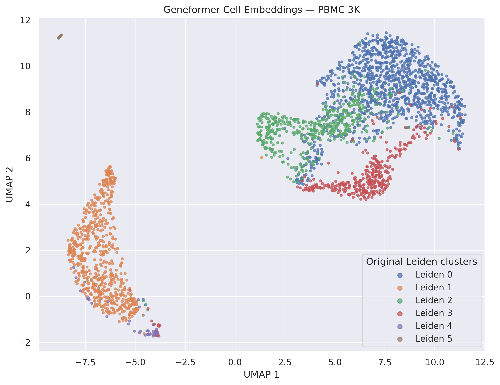
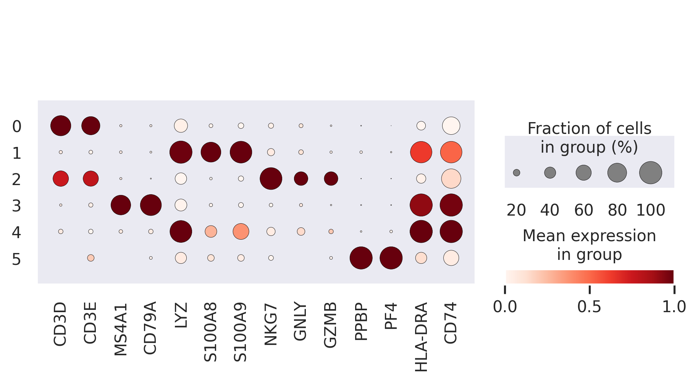

# Geneformer Foundation Model Analysis of PBMC Single-Cell RNA-seq

## Overview

This project explores pretrained Geneformer V1 cell embeddings using a PBMC single-cell RNA-seq dataset. It examines embedding structure, compares Geneformer embeddings with a reconstructed PCA baseline, and evaluates neighborhood consistency against existing Leiden cluster annotations.

## Objectives

- Generate cell embeddings using a pretrained transformer-based model.
- Visualize embeddings using UMAP.
- Examine marker genes and preliminary cell-type annotations.
- Compare embedding representations using silhouette scores.
- Evaluate nearest-neighbor consistency and document limitations.

## Dataset

- Cells analyzed: 2,671
- Leiden clusters: 6
- Geneformer embedding dimensions: 256

## Workflow

1. Prepare single-cell count data and Ensembl gene identifiers.
2. Tokenize cells with Geneformer V1.
3. Extract pretrained cell embeddings.
4. Visualize embeddings using UMAP.
5. Examine marker genes and annotate clusters.
6. Compare silhouette scores and nearest-neighbor consistency.

## Results

| Representation | Dimensions | Silhouette score |
|---|---:|---:|
| Geneformer V1 embeddings | 256 | 0.1015 |
| Reconstructed PCA baseline | 30 | 0.3044 |

Mean same-annotation fraction among five nearest neighbors: 0.8958.

## Preliminary cluster annotations

| Leiden cluster | Cell count | Annotation |
|---|---:|---|
| 0 | 1,183 | T cells |
| 1 | 638 | Myeloid cells / monocytes |
| 2 | 455 | NK / cytotoxic lymphocytes |
| 3 | 347 | B cells |
| 4 | 33 | Antigen-presenting cells; unresolved |
| 5 | 15 | Platelets |

## Figures

### Geneformer UMAP

### Marker-gene dot plot

## Limitations

- The PCA baseline was reconstructed and may not reproduce the original clustering representation.
- Silhouette scores measure alignment with the supplied labels, not biological correctness.
- Neighborhood consistency uses annotations derived from Leiden clusters and is not independent biological validation.
- The antigen-presenting cell group remains unresolved.
- Small clusters require cautious interpretation.

## Reproducibility

Embeddings and analysis outputs were generated in Google Colab using Geneformer V1 and Python single-cell analysis tools. A fully reproducible notebook and environment specification remain to be added.

## Future work

- Add the analysis notebook and environment details.
- Refine cell-type annotations.
- Implement a more rigorous permutation analysis.
- Explore independent biological validation.

## Reproducibility and setup

### Analysis notebook

The project workflow and preliminary findings are documented in
[`geneformer_pbmc3k_analysis.ipynb`](notebooks/geneformer_pbmc3k_analysis.ipynb).

**Current status:** The notebook currently documents the workflow and results.
It does not yet contain the complete executable analysis pipeline.

### Software environment

The package versions recorded from the Google Colab analysis are listed in
[`requirements.txt`](requirements.txt).

These versions are a starting point, not a complete environment lockfile.
Reproducing the full analysis may require additional dependencies, model files,
Geneformer resources, and access to the input dataset.

### Results

The `results/` directory contains the embedding matrix, UMAP coordinates,
cluster annotations, neighborhood-consistency metrics, and silhouette
comparison tables. The `figures/` directory contains the corresponding
visualizations.
