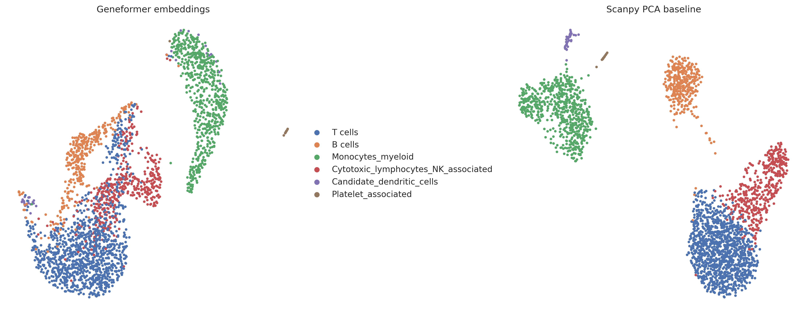

# Geneformer Foundation Model Analysis of PBMC Single-Cell RNA-seq

## Overview

This project explores pretrained Geneformer V1 cell embeddings using a
PBMC single-cell RNA-seq dataset. It compares Geneformer representations
with a conventional Scanpy PCA baseline and evaluates how well each
representation separates existing cell-type annotations.

## Objectives

- Generate cell embeddings using a pretrained transformer-based model.
- Visualize embeddings using UMAP.
- Examine marker genes and preliminary cell-type annotations.
- Compare representations using cosine silhouette scores.
- Document methodological limitations and reproducibility requirements.

## Dataset

- Cells analyzed: 2,671
- Annotated cell populations: 6
- Genes in the input matrix: 35,635
- Geneformer embedding dimensions: 256
- Conventional PCA dimensions: 50

The analysis uses a PBMC 3k dataset. Cell-type labels are preliminary
annotations and should not be treated as independent ground-truth labels.

## Workflow

1. Prepare the expression matrix and Ensembl gene identifiers.
2. Tokenize cells using Geneformer V1.
3. Extract pretrained cell embeddings using mean pooling of the final layer.
4. Validate cell barcodes, metadata alignment, and embedding values.
5. Visualize Geneformer embeddings using UMAP.
6. Reconstruct a conventional Scanpy baseline using normalized,
   log-transformed expression, 2,000 highly variable genes, and PCA.
7. Compare cell-type separation using cosine silhouette scores.
8. Save embeddings, coordinates, metrics, and comparison figures.

## Results

### Overall silhouette comparison

| Representation | Dimensions | Cosine silhouette |
|---|---:|---:|
| Geneformer V1 embeddings | 256 | 0.1075 |
| Scanpy PCA baseline | 50 | 0.2098 |

The difference (Geneformer minus PCA) was -0.1023.

In this PBMC dataset and under the tested configurations, the Scanpy PCA
representation achieved higher overall separation of the supplied
cell-type annotations than the Geneformer embeddings.

This is a descriptive result from one dataset and one Geneformer
embedding configuration. It does not establish that PCA is universally
superior to foundation-model representations.

### Cell-type-specific results

| Cell type | Cells | Geneformer mean silhouette | PCA mean silhouette |
|---|---:|---:|---:|
| B cells | 347 | -0.0363 | 0.3534 |
| Candidate dendritic cells | 33 | 0.5132 | 0.4851 |
| Cytotoxic lymphocytes / NK-associated | 457 | 0.0786 | 0.2034 |
| Monocytes / myeloid | 638 | -0.0167 | 0.2233 |
| Platelet-associated | 15 | 0.4297 | 0.7384 |
| T cells | 1,181 | 0.2126 | 0.1483 |

These per-cell-type values are descriptive means. Rare populations have
small sample sizes, particularly platelet-associated cells and candidate
dendritic cells. Their scores should therefore be interpreted cautiously.

### UMAP comparison

UMAP provides a visualization of neighborhood structure in each
representation. Absolute coordinates and positions are not directly
comparable between plots. Visual separation alone does not demonstrate
biological validity.

## Cell-type annotations

| Cell type | Number of cells |
|---|---:|
| T cells | 1,181 |
| Monocytes / myeloid | 638 |
| Cytotoxic lymphocytes / NK-associated | 457 |
| B cells | 347 |
| Candidate dendritic cells | 33 |
| Platelet-associated | 15 |

These are the annotations used for the current comparison. The rare
populations and the biological accuracy of the annotations require
additional validation.

## Results files

The `results/verified_comparison/` directory contains:

- `geneformer_embeddings_256d.csv` — validated embeddings, cell barcodes,
  Leiden labels, and cell-type annotations.
- `scanpy_pca_scores_50d.csv` — 50-dimensional PCA representation.
- `cell_type_silhouette_summary.csv` — per-cell-type comparison.
- `per_cell_silhouette_scores.csv` — per-cell silhouette values.
- `geneformer_umap_coordinates.csv` — Geneformer UMAP coordinates.
- `scanpy_pca_umap_coordinates.csv` — PCA-based UMAP coordinates.
- `geneformer_vs_scanpy_umap.png` — side-by-side UMAP comparison.
- `comparison_metrics.json` — summary metrics and limitations.
- `RESULTS_README.md` — concise summary of the comparison.

## Limitations

- Only one dataset and one Geneformer embedding configuration have been
  evaluated in this comparison.
- Silhouette scores measure separation relative to the supplied labels;
  they do not establish biological correctness.
- The cell-type annotations are preliminary and are not independent
  biological ground truth.
- Rare cell populations have small sample sizes.
- The PCA baseline uses 2,000 highly variable genes and 50 PCs, whereas
  Geneformer uses 256-dimensional mean-pooled final-layer embeddings.
- UMAP is a visualization and should not be used alone to rank methods.
- Alternative pooling strategies, model layers, and robustness checks
  have not yet been evaluated.

## Reproducibility

The analysis was conducted in Google Colab using Geneformer V1 and
Scanpy. The input data, model files, Geneformer dictionaries, and
software dependencies must be available to reproduce the analysis.

A runtime compatibility patch was needed during tokenization because
of pandas indexing behavior in the installed environment. The complete
tokenization and embedding-extraction workflow has not yet been packaged
as a fully executable, clean-environment pipeline. Reproducibility work
remains in progress.

See [requirements.txt](requirements.txt) for the current package
specification. These requirements are not yet a complete environment
lockfile.

For the tested Geneformer configuration, model and dictionary files,
tokenizer compatibility workaround, and remaining reproducibility tasks,
see [Geneformer Reproducibility Notes](docs/geneformer_reproducibility.md).

## Analysis notebook

The current analysis notebook is:

[geneformer_pbmc3k_analysis.ipynb](notebooks/geneformer_pbmc3k_analysis.ipynb)

The notebook documents the project workflow and preliminary findings.
Its complete end-to-end execution in a clean environment remains future
work.

## Future work

- Package the complete executable tokenization and embedding workflow.
- Document model and dictionary versions and preprocessing parameters.
- Evaluate alternative Geneformer embedding configurations.
- Conduct robustness analyses and assess uncertainty in comparisons.
- Refine cell-type annotations and seek independent biological validation.
